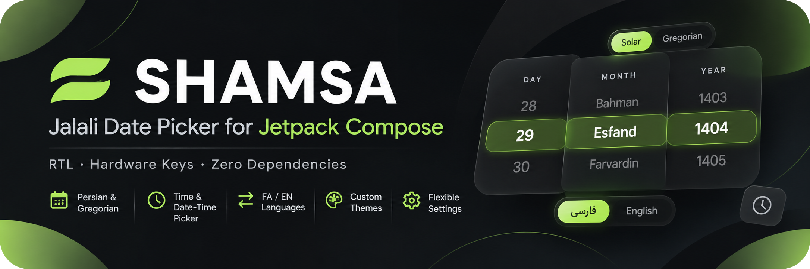

# Shamsa
[](https://central.sonatype.com/artifact/com.vimilad/shamsa)
[](LICENSE)





Jetpack Compose **date, time and date-time pickers** as modal bottom sheets, for the Jalali
(Persian) and the Gregorian calendar. Compact scrolling wheels, a confirm and a cancel button,
and nothing else.

- **Three pickers.** `ShamsaDatePickerBottomSheet`, `ShamsaTimePickerBottomSheet` and
  `ShamsaDateTimePickerBottomSheet` (date first, then time).
- **Two independent settings.** Library language (Persian or English) and calendar type
  (Jalali or Gregorian). English + Jalali shows `Farvardin`, `Ordibehesht`, ...
- **Zero third-party dependencies.** Only Compose. The calendar math is built in and is tested
  against the samanzamani `PersianDate` library.
- **Correct calendars.** Leap years and 29/30/31-day months are handled, and the day is clamped
  automatically when you scroll to a shorter month or a non-leap year.
- **Compact.** Each wheel shows three rows: previous, current and next.
- **Hardware keys.** D-pad, OK and cancel keys work out of the box, plus an optional key that
  moves focus between the wheels. Built for POS terminals and other devices with keypads.
- **Touch callback.** Get notified on every touch inside the picker
  (for example, to reset an inactivity timer).
- **Easy to theme.** Texts, colors and fonts are configurable from the outside.

## Installation

Shamsa is published to Maven Central.

```kotlin
// settings.gradle.kts
dependencyResolutionManagement {
  repositories {
    google()
    mavenCentral()
  }
}

// app/build.gradle.kts
dependencies {
  implementation("com.vimilad:shamsa:<version>")
}
```

The library is built with Compose BOM `2024.12.01` and Material 3. Your app needs Compose and
Material 3 on its own classpath. `minSdk` is 21.

## Quick start

### Date

```kotlin
@Composable
fun Screen() {
  var show by remember { mutableStateOf(false) }
  var date by remember { mutableStateOf<ShamsaDate?>(null) }

  Button(onClick = { show = true }) { Text("Pick a date") }

  if (show) {
    ShamsaDatePickerBottomSheet(
      onDismissRequest = { show = false },   // called after the sheet has closed
      onConfirm = { date = it },             // ShamsaDate(year, month, day, calendar)
    )
  }
}
```

`onDismissRequest` is called after the sheet closes for any reason (cancel, confirm,
swipe down, tap outside, Back), so always set your "show" state to `false` there.

### Time

```kotlin
ShamsaTimePickerBottomSheet(
    onDismissRequest = { show = false },
    onConfirm = { time: ShamsaTime -> /* time.hour, time.minute, time.second */ },
    showSeconds = false,   // adds a seconds wheel
    minuteStep = 5,        // minutes offered every 5 minutes
)
```

The time picker uses a 24-hour clock. The wheels are always hour, minute, second from left to right.

### Date and time

```kotlin
ShamsaDateTimePickerBottomSheet(
    onDismissRequest = { show = false },
    onConfirm = { value: ShamsaDateTime -> /* value.date, value.time */ },
)
```

The sheet has two steps, in order: first the date (button **Next**), then the time (buttons
**Confirm** and **Back**). The cancel key cancels the whole picker from either step.

## Language and calendar

`language` and `calendar` are two separate parameters. Any combination works:

| `language` | `calendar`  | Month names                 | Digits  | Direction |
|------------|-------------|-----------------------------|---------|-----------|
| `Persian`  | `Jalali`    | فروردین, اردیبهشت, ...      | Persian | RTL       |
| `Persian`  | `Gregorian` | ژانویه, فوریه, ...          | Persian | RTL       |
| `English`  | `Jalali`    | Farvardin, Ordibehesht, ... | Latin   | LTR       |
| `English`  | `Gregorian` | January, February, ...      | Latin   | LTR       |

```kotlin
ShamsaDatePickerBottomSheet(
    /* ... */
    language = ShamsaLanguage.English,
    calendar = ShamsaCalendar.Jalali,
)
```

The language is independent of the device language, so a Persian picker stays Persian on an
English device. The date you get back is expressed in the calendar you asked for, and you can
convert it at any time (see [Dates and times](#dates-and-times)).

## Parameters

Date picker (the time and date-time pickers share most of them):

| Parameter          | Default                                     | Description                                                |
|--------------------|---------------------------------------------|------------------------------------------------------------|
| `onDismissRequest` | required                                    | Called after the sheet has closed.                         |
| `onConfirm`        | required                                    | Called with the picked value.                              |
| `language`         | `Persian`                                   | Language of buttons, month names and layout direction.     |
| `calendar`         | `Jalali`                                    | Calendar of the wheels and of the returned date.           |
| `initialDate`      | today                                       | Selected at the start (converted to `calendar` if needed). |
| `yearRange`        | 1300..1500 (Jalali), 1920..2120 (Gregorian) | Years in the year wheel.                                   |
| `texts`            | `ShamsaDefaults.texts(language, calendar)`  | Button labels, month names, digit style.                   |
| `colors`           | `ShamsaDefaults.colors()`                   | Colors of every part.                                      |
| `textStyles`       | `ShamsaDefaults.textStyles()`               | Fonts and text styles.                                     |
| `onTouch`          | `{}`                                        | Called on every finger-down inside the sheet.              |
| `keys`             | `ShamsaKeys()`                              | Hardware key mapping.                                      |
| `focusKey`         | `null`                                      | Optional key that moves focus to the next wheel.           |

The sheets are always fully expanded (no half-open state). No experimental Material 3 type appears
in the public API, so your code does not need `@OptIn(ExperimentalMaterial3Api::class)`.

Only the time picker: `initialTime`, `showSeconds`, `minuteStep`. Only the date-time picker:
`initialDateTime`, `showSeconds`, `minuteStep`, plus the date parameters.
Each sheet has a matching `...Content` composable (without the sheet) if you want to host the
picker in your own dialog or screen.

## Customization

### Texts

All strings live in the library's `strings.xml` (Persian in `values`, English in `values-en`):
`shamsa_confirm`, `shamsa_cancel`, `shamsa_next`, `shamsa_back` and the 12-item arrays
`shamsa_months_jalali` and `shamsa_months_gregorian`.

Change them for the whole app by defining the same names in your own `strings.xml`, or per call:

```kotlin
ShamsaDatePickerBottomSheet(
    /* ... */
    texts = ShamsaDefaults.texts(
        language = ShamsaLanguage.English,
        calendar = ShamsaCalendar.Jalali,
        confirm = stringResource(R.string.select),
        cancel = "Close",
        usePersianDigits = false,
    ),
)
```

When you pass your own `texts`, repeat the `language` and `calendar` you used for the picker.

### Fonts

```kotlin
ShamsaDatePickerBottomSheet(
    /* ... */
    textStyles = ShamsaDefaults.textStyles(fontFamily = vazirmatn),
)
```

Without `textStyles` the picker uses `MaterialTheme.typography`, so a font set in your theme is
picked up automatically. `item`, `selectedItem` and `button` can also be set individually.

### Colors

Override only what you need; everything else follows your Material theme.

```kotlin
ShamsaDatePickerBottomSheet(
    /* ... */
    colors = ShamsaDefaults.colors(
        sheetContainer = Color(0xFF1B2B34),
        selectedRow = Color(0xFF2C4452),
        confirmContainer = Color(0xFFFFC857),
        confirmContent = Color.Black,
    ),
)
```

| Color                                | Used for                                     |
|--------------------------------------|----------------------------------------------|
| `sheetContainer`                     | Sheet background                             |
| `scrim`                              | Overlay behind the sheet                     |
| `dragHandle`                         | Drag handle at the top                       |
| `selectedRow`                        | Highlight bar behind the selected row        |
| `selectedText`                       | Selected row                                 |
| `focusedText`                        | Selected row of the wheel that has key focus |
| `unselectedText`                     | Previous and next rows                       |
| `confirmContainer`, `confirmContent` | Confirm button                               |
| `cancelContainer`, `cancelContent`   | Cancel button                                |

## Hardware keys

| Action                    | Default keys                     |
|---------------------------|----------------------------------|
| +1 on the focused wheel   | DPAD down, DPAD right            |
| -1 on the focused wheel   | DPAD up, DPAD left               |
| Confirm (or Next)         | DPAD center, Enter, Numpad Enter |
| Cancel (closes the sheet) | Escape, Back, Clear              |

- Key focus starts on the first wheel (day, or hour). **Touching a wheel moves key focus to it**,
  with or without a focus key.
- Pass `focusKey` to also move focus with a physical key. Each press moves to the next wheel
  and wraps around: day, month, year, day, ... (or hour, minute, second, hour, ...).
  `focusKey` takes precedence over every key in `ShamsaKeys`.
  ```kotlin
  ShamsaDatePickerBottomSheet(
      /* ... */
      focusKey = Key.Menu,
  )
  ```
- The focused wheel is drawn with `focusedText`. Set `focusedText` equal to `selectedText` to
  hide the indication.
- Every key down is one step. Values do not wrap around: a wheel stops at its first and last
  item, and the day never exceeds the length of the selected month.

Everything is configurable:

```kotlin
keys = ShamsaKeys(
    increase = setOf(Key.DirectionDown),
    decrease = setOf(Key.DirectionUp),
    confirm = setOf(Key.Enter),
    cancel = setOf(Key.Escape, Key.Back),
    debugLog = false,             // true: log every key event to Logcat (tag ShamsaKeys)
)

keys = ShamsaKeys.None   // turn hardware key handling off
```

If a key is listed in more than one set, the priority is cancel, confirm, increase, decrease.

## Touch callback

```kotlin
ShamsaDatePickerBottomSheet(
    /* ... */
    onTouch = { inactivityTimer.reset() },
)
```

`onTouch` fires on every finger-down anywhere on the sheet, including the drag handle. The event
is not consumed, so the picker behaves exactly as it would without the callback. Hardware key
presses do not trigger it.

## Dates and times

```kotlin
val d = ShamsaDate.jalali(1405, 8, 12)        // throws IllegalArgumentException for impossible dates
d.toGregorian()                               // ShamsaDate.gregorian(2026, 11, 3)
ShamsaDate.gregorian(2026, 11, 3).toJalali()  // 1405/08/12
d.convertTo(ShamsaCalendar.Gregorian)
d.toDate()                                    // java.util.Date at midnight, device time zone
ShamsaDate.today(ShamsaCalendar.Jalali)
ShamsaDate.from(date, calendar)               // from java.util.Date
ShamsaDate.isLeapYear(ShamsaCalendar.Jalali, 1403)       // true
ShamsaDate.monthLength(ShamsaCalendar.Jalali, 1403, 12)  // 30

ShamsaTime(14, 35)                            // hour, minute, second = 0
ShamsaDateTime(d, ShamsaTime(14, 35)).toDate()
```

`toString()` uses Latin digits: `1405/08/12`, `14:35:00`, `1405/08/12 14:35:00`.

## Accuracy

Wrong dates are the worst bug a date picker can have, so the calendar is tested heavily.

The Jalali math is [jalaali-js](https://github.com/jalaali/jalaali-js), which matches the
official Iranian calendar for years 1178 to 1633. It was compared with the
[samanzamani/PersianDate](https://github.com/samanzamani/PersianDate) library:

- Leap years and month lengths: identical for every year from 1178 to 1633.
- Jalali to Gregorian: identical for every day from 1178 to 1633.
- Both directions: identical for every day from 1300 to 1500 (the default picker range).

Outside 1178..1633 the two libraries use different rules and differ, so keep `yearRange` inside
that window.

The unit tests (`./gradlew :shamsa:testDebugUnitTest`) check, among other things:

- `golden-jalali-years.csv`: for every year 1178..1633, the leap flag and the Gregorian date of
  1 Farvardin, generated from the samanzamani library.
- Every day of those years against plain JDK date arithmetic (one day added at a time starting
  from the reference new-year date), in both directions.
- Year lengths, month lengths, round trips, Gregorian leap rules (1900, 2000, 2100, ...),
  validation of impossible dates, and conversions between calendars.

## Sample app

The `sample` module is a compact playground that fits on one screen:

- a results card with the last picked date, time and date-time, and a touch counter (`onTouch`)
- two segmented controls: library language (Persian or English) and calendar (Jalali or Gregorian),
  independent of each other
- three chips: show the **seconds** wheel, minutes in steps of 5, and a **custom theme**
  (font, colors and button texts, applied to every picker)
- four buttons: date picker, **time picker on its own**, **date-time picker** (date first, then
  time) and a date picker that starts on 30 Esfand 1403 (a leap-year day)

The `Menu` key is passed as the `focusKey`, so it moves key focus between the wheels.
Open the project in Android Studio and run `sample`.

## Building

```bash
./gradlew :sample:installDebug                 # run the sample on a device
./gradlew :shamsa:testDebugUnitTest            # unit tests
./gradlew :shamsa:assembleRelease              # AAR: shamsa/build/outputs/aar/shamsa-release.aar
```

An AAR does not contain its dependencies. If you use the AAR directly instead of the Maven
artifact, your app needs Compose and Material 3.

## Releasing

Publishing uses the [vanniktech maven-publish plugin](https://github.com/vanniktech/gradle-maven-publish-plugin)
and the Sonatype Central Portal. Put your credentials and signing key in `~/.gradle/gradle.properties`
(never in the repository):

```properties
mavenCentralUsername=<Central Portal token username>
mavenCentralPassword=<Central Portal token password>
signingInMemoryKey=<armored private key without header, footer and newlines>
signingInMemoryKeyId=<last 8 characters of the key id>
signingInMemoryKeyPassword=<key password>
```

```bash
./gradlew :shamsa:publishToMavenCentral --no-configuration-cache
```

Then publish the deployment from the Central Portal UI, or use `publishAndReleaseToMavenCentral`
to release automatically. Versions on Maven Central are immutable.

## License

```
Copyright 2026 Milad Mohammadi

Licensed under the Apache License, Version 2.0 (the "License");
you may not use this file except in compliance with the License.
You may obtain a copy of the License at

    http://www.apache.org/licenses/LICENSE-2.0

Unless required by applicable law or agreed to in writing, software
distributed under the License is distributed on an "AS IS" BASIS,
WITHOUT WARRANTIES OR CONDITIONS OF ANY KIND, either express or implied.
See the License for the specific language governing permissions and
limitations under the License.
```